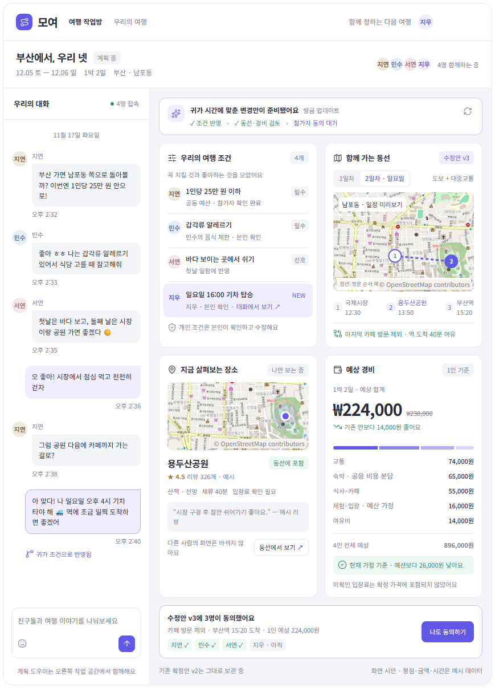
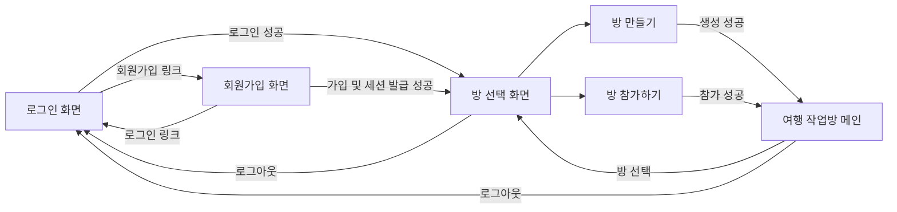

# 모여 여행 작업방 UI 설계

작성일: 2026-11-18 · 상태: 승인 설계

> 후속 구현 요청에 따라 `codex/workspace-ui`에서 구현했다. 아래 미구현·미착수 표현은 설계 작성 시점이며, 현재 결과는 [구현·검증 기록](../../verification/workspace-ui.md)을 따른다.

기준: 로컬 `develop`의 `1bc1941b113d1cdc2d74fd200471715ac5c77bd7`. 원격 최신 상태를 확인했다는 뜻은 아니다. 작성 중 다른 작업이 진행될 수 있으므로 이 커밋의 화면·계약을 기준으로 한다.

## 1. 요청과 설계 결정

사용자 요청은 첨부 화면처럼 여행 작업방을 구성할 수 있도록 Markdown으로 설계하는 것이다. 기술 선택을 먼저 보고한 뒤 설계를 요청받았으므로 **바닐라 HTML/CSS/JavaScript ES modules를 유지**한다.

추가 요구를 다음과 같이 반영한다.

- **로그인과 회원가입은 각각 별도 페이지**로 제공한다.
- **로그인 → 방 생성 또는 방 참가 선택 → 메인 화면** 순서로 진입한다.
- 메인 화면에는 계정 입력 폼과 최초 방 생성·참가 폼을 상시 노출하지 않는다.
- 메인은 첨부 화면의 왼쪽 채팅, 오른쪽 상태 배너·4개 카드·동의 바로 구성한다.

이 문서는 화면·상태·변경 범위의 설계다. 제품 코드 작성, 의존성 설치, 동결 계약 변경, 커밋·push·PR 생성은 이번 작업에 포함하지 않는다. 아래 새 파일과 동작은 향후 구현 제안이며 현재 존재하는 기능으로 간주하지 않는다.

### 선택한 방식과 대안

| 방식 | 판단 |
| --- | --- |
| 바닐라 유지, 영역별 렌더러 정리 | 채택. 현재 인증·HTTP·SSE·지도·상태 모듈을 활용하며 화면 구조를 변경한다. |
| React로 화면 전환 | 이번 범위에서는 제외. 컴포넌트 관리 장점이 있지만 빌드·정적 제공·지도 생명주기·UI 테스트 전환이 함께 필요하다. |

전체 방 목록, 실시간 접속 표시, 평점·리뷰 수집, 교통수단 추가는 이번 화면 설계의 필수 구현 범위로 삼지 않는다. 계약에 없는 기능은 9절에 차이를 명시한다.

## 2. 참고 화면과 현재 develop



이미지는 약 869×1206 크기의 시각 기준이다. 이미지의 부산·참가자 이름·날짜·가격·3명 동의 등의 값은 예시이며 live 화면에 하드코딩하지 않는다. 브랜드 표기는 이미지의 **모여**를 사용하는 제안이다. 기존 대표 fixture의 여수 여행과 실제 방 설정은 유지한다.

| 현재 파일·문서 | 현재 역할 | 이번 설계에서의 활용 |
| --- | --- | --- |
| [frontend/index.html](../../../frontend/index.html) | 계정·방 입력·여행 작업 패널을 한 페이지에 배치 | 인증·진입 영역을 분리하고 작업방 레이아웃으로 변경 |
| [frontend/src/room.js](../../../frontend/src/room.js) | 방 입장·입력 바인딩·공동 화면 렌더링 | 메인 전용 진입점과 이벤트 조정자로 유지 |
| [frontend/src/state.js](../../../frontend/src/state.js) | 공동 스냅샷, 사용자, 개인 선택 장소 | 소유권·응답 순서 방어를 유지 |
| [frontend/src/plan.js](../../../frontend/src/plan.js) | 표시안 선택, target 비교, 확인·철회 | 같은 검토 대상 확인 규칙을 유지 |
| [frontend/src/map.js](../../../frontend/src/map.js) | 공동 지도와 개인 지도의 분리 | 두 지도와 키 미설정 대체 표현 유지 |
| [공통 계약 v0.2](../../contracts/travel-api.md) | HTTP·SSE·DTO·비용·동의 기준 | 계약을 변경하지 않는 기본 범위 |
| [기존 FE 계획](../plans/2026-11-18-frontend.md) | 바닐라·같은 origin·fixture와 live 분리 | 기술 구성과 도메인 규칙을 계승. 화면 배치와 진입 흐름은 본 제안으로 구체화 |

## 3. 페이지 분리와 진입 흐름

### 3.1 페이지와 주소

| 페이지 | 주소 제안 | 핵심 내용 | 다음 이동 |
| --- | --- | --- | --- |
| 로그인 | `/login.html` | 이메일·비밀번호, 로그인 버튼, 회원가입 링크 | 로그인 성공 → `/rooms.html` |
| 회원가입 | `/signup.html` | 이름·이메일·비밀번호·비밀번호 확인 | 가입 성공 → `/rooms.html` |
| 방 선택 | `/rooms.html` | **방 만들기 / 방 참가하기** 두 버튼 | 생성·참가 성공 → `/` |
| 여행 작업방 | `/` 또는 `/index.html` | 첨부 화면에 해당하는 메인 | 방 선택·여행 설정·로그아웃 |

`.html` 주소는 현재 Node 정적 서버와 FastAPI 정적 mount가 제공할 수 있는 형식이다. 새 화면을 위해 API나 서버 라우팅 체계를 바꾸지 않는다. `/dev` 개발자 화면은 독립적으로 유지한다.



### 3.2 로그인 화면

- 연한 회색 바탕 중앙에 최대 400px의 흰 카드. 보라색 아이콘·모여 로고·“함께 여행을 계획해요” 안내를 배치한다.
- 이메일, 비밀번호, “로그인” 버튼, “계정이 없으신가요? 회원가입” 링크만 둔다. 작업방 패널은 표시하지 않는다.
- `POST /api/auth/login`에 `{email,password}`를 보낸다. 전송 중 버튼을 비활성화해 중복 제출을 막는다.
- 성공하면 **항상 방 선택 화면으로 이동**한다. 이전 방 ID가 남아 있어도 로그인 성공 직후 메인으로 바로 보내지 않는다.
- 잘못된 자격 정보(401)는 폼 안에 안내한다. 네트워크·서버 오류는 재시도를 제공한다. 비밀번호는 저장하지 않는다.

### 3.3 회원가입 화면

- 로그인과 같은 시각 스타일의 별도 페이지에 이름·이메일·비밀번호·비밀번호 확인을 배치한다.
- 비밀번호는 현재 서버 계약에 맞춰 최소 8자, 확인 값 일치를 브라우저에서 검사한다. 확인 값은 API에 보내지 않는다.
- `POST /api/auth/register`에 `{name,email,password}`를 보낸다. 중복 이메일(409), 입력 검증(422), 통신 오류를 폼 안에 구분해 안내한다.
- 현재 서버는 가입 성공 시 세션 cookie도 발급하므로 다시 로그인을 요구하지 않고 방 선택 화면으로 이동한다.
- 소셜 로그인·이메일 인증·비밀번호 재설정은 현재 endpoint가 없어 이 설계에 추가하지 않는다.

### 3.4 방 선택 화면

- 상단은 로고·사용자 이름·로그아웃, 본문은 “어떤 여행을 함께할까요?”와 **방 만들기 / 방 참가하기** 두 개의 동등한 진입 카드를 둔다. 전체 방 목록처럼 보이는 가짜 목록은 만들지 않는다.
- “방 만들기”를 누르면 같은 페이지에서 생성 폼을 연다. 방 이름·지역·기간·활동 시간·1인 예산·이동수단 자동차를 기본 항목으로, 출발지·귀가지·숙소·고정비를 추가 설정으로 제공한다. 기존 `readTripConfig`, 고정비 입력 로직을 재사용한다.
- 거점 미입력으로 서버가 허용하는 방은 생성할 수 있다. 메인에서 기존 질문 흐름으로 보완하며, 좌표 입력이 필요하면 명칭·위도·경도 수동 입력을 제공한다. 현재 없는 장소 자동완성을 가정하지 않는다.
- 생성은 `POST /api/rooms`, 참가는 초대 코드 입력 후 `POST /api/rooms/join`을 사용한다.
- 성공한 `RoomSnapshot.room_id`만 live에서는 기존 `sessionStorage`의 `trip-room`에 저장한 뒤 `/`로 이동한다. fixture의 키와 이동 규칙은 6.1절을 따른다. 실패 시 현재 폼에 남고 입력을 보존한다. 단순 버튼 클릭으로는 메인에 진입하지 않는다.
- 방 생성자·참가자 역할에 따라 서버가 주지 않은 별도 관리자 권한을 만들지 않는다.

### 3.5 페이지 진입과 세션 처리

| 상황 | 처리 |
| --- | --- |
| 로그인·가입 페이지에 이미 인증된 사용자가 접근 | `/api/auth/me` 성공 후 방 선택으로 이동 |
| 비인증 사용자가 방 선택·메인에 직접 접근 | `/api/auth/me`의 401 확인 후 로그인으로 이동 |
| 인증된 사용자가 선택한 방 없이 메인에 접근 | 방 선택으로 이동 |
| 메인을 새로고침 | 저장한 방 ID를 사용해 서버에서 스냅샷을 다시 받고 메인 복원 |
| 저장한 방 조회가 403/404 | 선택 ID를 지우고 방 선택에서 “방에 접근할 수 없습니다” 안내 |
| 초기 조회가 네트워크 오류·5xx | 로그인·방 선택으로 오인 이동하지 않고 재시도 표시 |
| 사용 중 세션 만료 | SSE를 닫고 재로그인 안내. 작성 중 텍스트가 갑자기 사라지지 않도록 자동 페이지 이동은 하지 않음 |
| 로그아웃 성공 | SSE 종료, 선택 방과 메모리 상태 정리 후 로그인으로 이동 |

공통 요청 모듈은 HTTP 상태값을 `error.status`로 보존하도록 보완한다. 기존 메시지 기반 Error 사용과 같은 origin cookie 요청 방식은 유지한다. 로그인 실패의 401과 보호 페이지 진입의 401을 동일한 전역 리다이렉트로 처리하지 않는다.

## 4. 메인 레이아웃과 시각 기준

### 4.1 구성

```text
┌─────────────────────────────────────────────────────────────┐
│ 모여  여행 작업방  방 선택                         사용자 메뉴 │
├─────────────────────────────────────────────────────────────┤
│ 방 제목 · 계획 상태                참가자 아바타 · N명 참여  │
│ 여행 날짜 · 기간 · 지역                        초대 코드/복사│
├───────────────────┬─────────────────────────────────────────┤
│ 우리의 대화        │ Agent 상태 배너                         │
│ 참여자 수          ├────────────────────┬────────────────────┤
│                   │ 우리의 여행 조건   │ 함께 가는 동선     │
│ 날짜 / 말풍선      │ 조건·질문·충돌     │ 날짜 탭·공동 지도  │
│                   ├────────────────────┼────────────────────┤
│                   │ 지금 살펴보는 장소 │ 예상 경비          │
│                   │ 개인 지도·상세     │ 개인 합계·방 소계  │
│                   ├────────────────────┴────────────────────┤
│ 메시지 입력        │ 표시안 동의 현황 · 나도 동의하기       │
└───────────────────┴─────────────────────────────────────────┘
```

- 페이지 바깥 여백 6~16px, 최대 폭 1440px, 테두리 1px, 모서리 20px의 흰 shell을 사용한다.
- 상단 내비게이션 약 64px, 방 요약 약 84px. 본문은 채팅 약 30%, 작업 영역 약 70%다. 넓은 화면에서는 채팅 폭을 약 360px로 제한한다.
- 869px 참고 크기에서는 shell 약 857px, 채팅 약 257px, 오른쪽 약 600px. 오른쪽 내부 여백 16px·열 간격 12~14px로 약 276px 카드 두 개를 배치한다. 기존 `body`의 `min-width:1050px`는 사용자 페이지에서 해제해야 한다.
- 오른쪽 첫 줄은 조건/동선, 둘째 줄은 장소/경비다. 카드 높이는 내용에 따라 늘어나며, 사진처럼 보이게 하려고 필수 질문·충돌·출처를 잘라내지 않는다.
- 데스크톱은 shell을 viewport 높이로 구성하고 채팅 메시지 목록과 오른쪽 작업 영역을 각각 스크롤한다. 채팅 입력은 채팅 하단에 유지한다. 동의 바는 오른쪽 본문 마지막에 놓으며 모달이나 고정 overlay로 카드를 덮지 않는다.
- 820px 미만은 문서 스크롤과 세로 배치로 전환하고 카드도 한 열로 쌓는다. 별도 모바일 기능을 만들지 않고 가로 넘침을 방지한다. 인증·방 선택 화면은 화면 폭에 맞춰 카드가 줄어든다.

### 4.2 스타일 토큰 제안

| 항목 | 기준 |
| --- | --- |
| Primary | `#6654F0`: 주요 버튼, 선택 탭, 개인 말풍선 강조 |
| Primary tint | `#EFECFF`: 새 조건·내 말풍선 바탕 |
| Canvas / Card | `#F5F5FA` / `#FFFFFF` |
| Text / Muted | `#17243B` / `#69758C`. 작은 보조 문구도 대비를 확보 |
| Border | `#E4E7F1`, 카드 radius 16px, 그림자 최소화 |
| 간격 | 4·8·12·16·24px 단위 |
| 글자 | 한국어 system font 우선. 본문 13~14px, 카드 제목 14~16px, 방 제목 20px, 대표 금액 30~32px |
| 상태색 | 언급 빨강·다수 지지 노랑·공식 확정 초록. 보라색은 브랜드/선택용이며 확정 의미로 사용하지 않음 |

아이콘은 작은 SVG 또는 기존 HTML/CSS 표현을 사용하고 아이콘 라이브러리 의존성을 추가하지 않는다. 키보드 focus, 버튼 이름, 상태 텍스트를 제공하고 색상만으로 상태를 구분하지 않는다. 40~44px 수준의 조작 영역을 확보한다.

## 5. 메인 영역별 동작과 데이터

### 5.1 헤더와 방 요약

- 방 이름은 `snapshot.title`, 일정·지역은 `config`, 참가자 이름·아바타는 `members`를 사용한다. 아바타는 이름 글자와 ID에 따른 일정한 색으로 만든다.
- “4명 접속” 대신 **“4명 참여”**를 표시한다. `Member`에는 온라인 상태가 없다.
- 계획 상태는 표시안 없음/준비 중/입력 필요/충돌/검토 중/공식 확정을 텍스트로 구분한다. 공식 확정 여부는 서버 스냅샷으로 판단한다.
- “방 선택”은 `/rooms.html`로 이동한다. 사용자 메뉴는 로그아웃을 제공한다. 방 요약의 “여행 설정”에서 기존 여행 입력 수정 폼을 dialog로 연다.
- 초대 코드를 확인·복사할 수 있게 한다. 복사 실패 시 코드를 직접 선택할 수 있도록 유지한다.

### 5.2 왼쪽 채팅

- `messages`를 메시지 ID 기준으로 표시한다. 내 메시지는 오른쪽 연보라, 다른 사람은 왼쪽 회색 말풍선과 이름·아바타를 사용한다.
- `created_at`은 Asia/Seoul 기준 날짜 구분선과 시각으로 표시한다. 원본 메시지 내용은 HTML escape하고 이름·본문·시각을 읽을 수 있게 한다.
- 입력은 여러 줄 textarea, 전송 버튼, Enter 전송/Shift+Enter 줄바꿈을 제공한다. 한글 IME 조합 중 Enter는 전송하지 않는다. 전송 성공 후에만 입력을 비우며 실패하면 보존한다.
- POST 응답과 SSE로 같은 메시지를 받아도 한 번만 표시한다. 사용자가 아래를 보고 있을 때만 자동 스크롤하며 이전 대화를 읽고 있으면 “새 메시지” 이동 버튼을 제공한다.
- “이전 대화”와 조건의 “대화에서 보기”는 기존 메시지 API·`data-message` 연결을 유지한다.
- 채팅은 사람의 대화다. Agent 실행 결과를 가상의 사람 메시지로 삽입하지 않고 오른쪽 상태 배너에 표시한다.

### 5.3 Agent 상태 배너

| 서버 상태 | 표시 예 | 제공 동작 |
| --- | --- | --- |
| `idle` | 여행 이야기를 기다리고 있어요 | 새 메시지 입력 안내 |
| `running` | 조건과 동선을 검토하고 있어요 | 진행 표시, 중복 재계획 요청 방지 |
| `needs_input` | 확인이 필요한 내용이 있어요 | 질문·차단 충돌 수와 해당 영역 이동 |
| `done` | 여행안 검토가 끝났어요 | 표시안 revision 및 동의 영역 이동 |

`agent_status.label`을 기본 문구로 사용하고 열린 질문·충돌 수를 보조 정보로 표시한다. 현재 DTO에 없는 “카페를 제외하고 역 도착을 40분 앞당겼어요” 같은 변경 요약을 만들어내지 않는다. 새로고침 아이콘을 둔다면 “최신 상태 새로고침”으로 명명하고 GET 조회에 연결한다. 실제 재계획은 별도의 “다시 계획” 동작으로 기존 `manual_replan` API에 연결한다.

### 5.4 우리의 여행 조건 카드

- `constraints`의 소유자, 사람이 읽을 수 있는 조건명·값, `hard→필수` / `preference→선호`, 상태를 표시한다. `superseded`는 기본 목록에서 숨기고 필요 시 변경 이력으로 펼친다.
- `needs_owner_confirmation→본인 확인 필요`, `confirmed→본인 확인됨`으로 표시한다. 본인 확인을 실제 충족 검증 완료와 혼동하지 않는다.
- 본인 조건만 “수정 / 본인 확인”을 제공한다. 다른 사람에게는 읽기·근거 대화 이동만 제공한다.
- 같은 카드 안에서 **확인 질문**과 **해결할 충돌**을 별도 구역으로 펼친다. 질문이 있거나 충돌이 열려 있으면 관련 안내를 접힌 상태에 묻지 않는다.
- 질문 입력은 현재 `field`에 맞게 거점, 메뉴·수량·공유, 체류시간, 조건 값, 지지 대상 폼을 제공한다. 최종 제출 JSON 형태와 소유자 제한은 기존 계약을 따른다. 지원하지 않는 조건 값은 JSON 보조 입력으로 남기고 의미를 임의 변환하지 않는다.
- `budget/budget_krw`는 원화, `return_by`는 귀가지 도착 제한 시각으로 표현한다. 현재 AI의 자동 필수 조건 검증 범위 밖인 알레르기 등의 조건은 확인·추가 근거가 필요한 상태로 유지한다.
- 최근 조건 강조는 현재 브라우저에서 이전 스냅샷과 비교한 변경 표시다. 첫 로드에서 모든 조건에 NEW를 붙이지 않는다. `source_message_ids`는 근거 이동에 사용한다.

### 5.5 함께 가는 동선 카드

- 표시 기준은 기존 `displayPlan(snapshot) = review_plan ?? current_plan`이다. revision, 날짜 탭, 지도, 일정 목록, 경비, 하단 동의 바가 같은 표시안을 사용한다.
- 기본 날짜는 표시안의 첫날이며 날짜 탭 변경은 **개인 화면 상태**다. 새 스냅샷에도 해당 날짜가 있으면 선택을 유지한다.
- 지도는 선택한 날의 `visits`와 `route_legs.polyline`을 표시한다. 방문 순서 번호·아래 시간표를 연결한다. 번호는 순서 표시이며 지지·확정 색상과 구분한다.
- 이동수단 표시는 **자동차**다. 도보·대중교통 스위치를 동작하는 것처럼 표시하지 않는다.
- 방문 항목 클릭은 해당 `place_ref`의 개인 상세 조회만 수행한다. 방문 순서를 지도 드래그로 임의 수정하지 않는다.
- 필수 조건 `return_by`는 마지막 날 공통 `destination` 도착 기준이다. 기차 출발·개인 환승 완료를 보장하는 문구로 바꾸지 않는다. 정확한 도착 여유 시간은 현재 별도 검증 결과 필드가 없어 기본 카드에서 제시하지 않는다.
- 지도 SDK 키가 없거나 로딩에 실패하면 방문 순서·좌표·서버 이동시간 목록을 보여준다. 사진처럼 지도를 꾸미기 위해 실제 지도인 것처럼 보이는 대역을 사용하지 않는다.
- Kakao SDK를 유지한다. 지도 출처 표시는 실제 제공자 규칙을 따르고 이미지의 OpenStreetMap 표식을 그대로 복제하지 않는다. 실제 키·도메인 연결은 구현 후 별도 확인한다.

### 5.6 지금 살펴보는 장소 카드

- **나만 보는 중** 표식을 고정한다. 선택 장소 상태는 공동 스냅샷에 넣지 않는다.
- 미선택 상태에는 “동선에서 장소를 선택해 주세요”를 표시한다. 임의 장소를 공동 선택으로 추가하지 않는다.
- 선택 후 개인 지도·장소명·주소·영업시간·메뉴 가격·현재 표시안 포함 여부를 보여준다. 메뉴·가격·영업시간의 출처·조회 시각·미확인/추정 여부는 접을 수 있는 근거 영역에 유지한다.
- 별점·리뷰 수·리뷰 문장은 DTO에 없으므로 기본 설계에서 제외한다. 이미지의 리뷰 인용 자리에는 영업시간·주소·주의가 필요한 근거 정보를 배치한다.
- “동선에서 보기”는 선택 날짜와 해당 방문 위치를 찾아 공동 지도 카드로 스크롤할 뿐, 서버 계획을 수정하지 않는다. 해당 장소가 현재 표시안에 없으면 포함 배지를 보여주지 않는다.
- 빠르게 A→B를 선택하거나 방·target이 바뀐 뒤 A 응답이 늦게 도착해도 B 화면을 덮지 않는 기존 요청 순서 방어를 유지한다.

### 5.7 예상 경비 카드

- 큰 금액은 `displayedPlan.cost.per_person_krw[currentUser.id]`의 **내 전체 계획액**이다. 제목 옆에 “내 기준”을 표시한다. 전체 합계를 단순히 인원수로 나누지 않는다.
- `paid_by_user_krw`는 내 기지출, `remaining_budget_krw`는 **앞으로 쓸 수 있는 금액**, `planned_balance_krw`는 **계획 반영 후 여유**로 표시한다. 세 항목을 서로 바꾸어 쓰지 않는다.
- 카드 아래에 `total_krw`의 방 전체 계획액과 `known_total_krw`의 알려진 소계를 구분해 보여준다.
- 비용 행의 `subtotal_krw`는 **방 전체 소계**다. 상세 영역을 “방 전체 비용 내역”으로 명시하고 분담 방식·소유자·기지출/예정·근거·가정을 함께 표시한다. 행별 개인 분담액을 프런트에서 다시 계산하지 않는다.
- 상단 막대는 값이 모두 알려진 경우 방 전체 비용의 카테고리 구성비로만 표시한다. 카테고리는 현재 enum을 교통(`intercity_transport`,`car`), 숙박, 식사, 입장·체험, 기타로 묶을 수 있다. 개인별 구성비라고 표시하지 않는다.
- 값이 `null`이면 “미확인” 또는 “총액 미확정”으로 표시한다. 알려진 금액과 미확인·추정 건수를 남기고 완전한 합계나 0원처럼 표현하지 않는다.
- 이전 금액 취소선·“14,000원 절약”은 비교 기준 DTO가 없으므로 기본 화면에서 제외한다. 예산 대비 여유는 서버의 `planned_balance_krw` 값으로만 표현한다.

### 5.8 하단 전체 여행안 동의 바

- “수정안 vN에 N명이 동의했어요”와 참가자별 동의/아직 표식을 표시한다. 같은 `confirmation_target`의 `stance=confirm`만 세고, 중복 사용자는 한 번만 센다.
- **3/4는 검토 중**이다. 4/4여도 서버의 동일 대상 `confirmed_plan`을 받기 전에는 “모두 동의 · 확정 확인 중”으로 표시한다.
- 내 확인이 없으면 “나도 동의하기”, 있으면 “내 동의 철회”를 제공한다. 현 API 이름 `confirm/withdraw`와 본문 `{target}`는 유지한다. 전송 중 중복 클릭을 막는다.
- 동의 가능 조건은 계획 존재, 현재 참가자·조건·근거 기반 일치, `validation=ready`, 차단 충돌 없음, 본인 확인 대기 필수 조건 없음이다. 미충족이면 버튼 옆에 이유와 해당 질문·충돌로 이동하는 동작을 제공한다. 최종 판단은 서버가 한다.
- target은 참가자·조건·근거·계획 revision의 네 값과 `content_hash` 전체를 사용한다. FE에서 새 hash를 만들거나 revision 번호만 비교하지 않는다.
- 검토 중 새 초안이 도착하면 기존 검토안·동의 표는 유지하고 “새 초안 vN이 있어요 / 새 안으로 전환”을 별도로 제공한다. 전환은 `plan/activate` 성공 응답 후 처리하며 과거 표를 새 안에 복사하지 않는다.
- 이전 확정안은 “이전 확정안 보기”로 읽기 전용 열람한다. 과거 항목명·버전은 해당 `item_snapshots`를 사용한다. 이 보기 안에 현재 동의 버튼을 붙이지 않는다.
- 항목의 빨강/노랑/초록 상태와 충돌 `!`는 동선 방문 목록·상세 공동 항목 영역에 남긴다. 보라색 지도 번호나 전체 동의 인원으로 항목 상태를 재계산하지 않는다.

## 6. 상태·갱신·오류 원칙

- 서버 소유: 인증, 방 참가자, 메시지, 조건, 항목 지지, 질문·충돌, 일정·비용, target, 확정 결과.
- 브라우저 개인 상태: 선택 날짜·장소, 열린 설정·질문 폼, 입력 중 텍스트, 스크롤 위치. 사용자 계정·비밀번호·비밀 키·개인 선택을 공동 snapshot에 섞지 않는다.
- 현재의 방별 SSE 한 연결과 네 이벤트(`message.created`, `room.updated`, `agent.status`, `plan.confirmed`)를 유지한다. 방 이동·로그아웃·메인 종료 시 연결을 닫는다.
- 스냅샷은 같은 방인지와 `seq`를 확인한 후 반영한다. SSE 재연결은 최신 서버 스냅샷을 조회한다. 새로고침 실패를 fixture 성공으로 대체하지 않는다.
- 렌더링은 영역별로 나눈다. 메시지 도착마다 전체 shell·지도 host·입력 폼을 `innerHTML`로 교체하지 않는다. 열려 있는 입력값·focus·채팅 스크롤·개인 지도 상태를 보존한다.
- 지도는 표시 target 또는 선택 날짜/장소가 바뀔 때 필요한 부분을 갱신한다. 채팅만 늘었을 때 장소 상세를 전부 재조회하거나 지도를 재생성하지 않는다.
- 계획 없음은 빈 카드와 다음 입력 안내, 조회 중은 로딩, 실패는 해당 영역의 재시도로 구분한다. 기존 내용을 최신 값처럼 보이게 남기지 않고 갱신 실패 상태를 함께 표시한다.
- 동의·충돌 선택의 409는 대상 변경 안내와 최신 조회로 처리한다. 이전 target으로 자동 재시도하지 않는다. 403은 권한 안내, 422는 입력 안내로 남긴다.
- fixture 모드는 명시적 `?mode=fixture`에서만 사용한다. 개발 모드 표식을 페이지 전반에 유지하고 live 오류로 자동 전환하지 않는다. fixture와 live의 선택 방 ID는 저장 공간을 분리한다.

### 6.1 fixture의 다중 페이지 이동

기존 fixture는 모듈 메모리만 사용하고 `/auth/me`도 항상 성공한다. 그대로 페이지를 나누면 로그인 화면을 건너뛰거나 방 설정이 사라지므로 다음 보완을 구현 범위에 포함한다.

- 로그인·회원가입·방 선택·메인 사이의 링크, 성공 이동, 인증 가드는 **현재 모드만** 전달한다. fixture일 때 목적지에 `?mode=fixture`를 붙이고, live에서는 붙이지 않는다. 모드 전환은 개발자가 명시적으로 선택한 경우에만 한다.
- fixture의 첫 진입은 미인증 상태다. `/auth/me`는 fixture 세션이 없으면 `error.status=401`, 로그인/가입 시나리오 성공 후에는 지정된 `fixtureUser` DTO를 반환한다. 실제 cookie 인증·계정 생성·자격 정보 검증을 재현했다고 표현하지 않는다.
- 개발 화면에는 “개발용 fixture · 실제 계정/여행 데이터 아님” 표식을 유지한다. fixture 로그인/가입의 입력값은 실제 계정으로 저장하지 않으며 비밀번호·요청 본문을 남기지 않는다.
- `sessionStorage`의 `trip-fixture-session-v1`에는 fixture 인증 여부·선택 사용자 ID·방 snapshot·선택 시나리오 ID만 보존한다. 이 값으로 페이지 진입 시 기존 fixture 모듈을 복원한다. 실제 계정 정보·live 방 snapshot과 공유하지 않는다.
- 선택 방 키는 live의 `trip-room`과 fixture의 `trip-fixture-room`을 분리한다. 생성·참가 및 시나리오 변경을 저장한 뒤 이동하며 새 문서에서 initial fixture로 덮어쓰지 않는다. 장소 대역 데이터는 저장된 시나리오에 대응하는 fixture에서 복원한다.
- fixture 로그아웃은 fixture 세션·선택 방을 초기화한다. 시나리오 재생/초기화는 fixture 데이터에만 작용한다. 저장 데이터 형식이 달라지거나 파싱에 실패하면 fixture만 초기화하고 fixture 로그인 화면으로 이동한다.
- 테스트에서는 명시적인 fixture 초기화 도우미를 사용해 각 사례의 미인증/인증 상태를 설정한다. 로그인 → 방 선택 → 생성/참가 → 메인 → 새로고침 흐름을 확인한다. 실제 다중 브라우저 전달·인증은 Backend 통합 검증으로 별도 확인한다.

## 7. 파일별 변경 설계

아래는 **앞으로 변경할 파일**이다. 이 문서 작성 단계에서 제품 파일을 수정하지 않는다.

| 파일 | 책임 |
| --- | --- |
| `frontend/login.html`, `signup.html` 신규 | 서로 독립된 로그인·회원가입 문서와 진입 스크립트 연결 |
| `frontend/rooms.html` 신규 | 방 생성/참가 선택과 각 입력 폼 |
| `frontend/index.html` 변경 | 작업방 shell, 2열 본문, 네 카드, 동의 바. 기존 계정·최초 입장 폼 분리 |
| `frontend/workspace.css` 신규 | 사용자 페이지 전용 토큰·카드·채팅·반응형·인증/방 선택 스타일. 기존 CSS 다음에 로드 |
| `frontend/src/auth-page.js` 신규 | 로그인/가입 제출·입력 검증·인증된 사용자 이동. 두 페이지는 page marker로 구별 |
| `frontend/src/session.js` 신규 | `/me` 조회, 보호 페이지 진입, HTTP 상태별 인증 처리, 로그아웃 등 공통 흐름 |
| `frontend/src/fixture-session.js` 신규 | 개발 모드 세션·snapshot의 페이지 간 보존과 초기화. live 저장 공간과 분리 |
| `frontend/src/rooms-page.js` 신규 | 생성/참가 폼 전환, 성공한 방 ID 저장, 메인 이동 |
| `frontend/src/trip-form.js` 신규 | 기존 trip/fixed-cost 입력 복원·읽기·검증을 생성 폼과 메인 설정에서 공유 |
| `frontend/src/workspace-view.js` 신규 | 헤더·배너·참가자·선택 날짜 등 화면 표현. 서버의 합의·비용 계산을 복제하지 않음 |
| `frontend/src/chat.js` 신규 | 말풍선·날짜·증분 갱신·스크롤·전송 입력 UX |
| `frontend/src/room.js` 변경 | 인증 확인 후 방 복원, 메인 바인딩·렌더러 조정. 계정·최초 생성 처리는 별도 페이지로 이동 |
| `frontend/src/api.js` 변경 | 실패 응답의 HTTP status 보존. 기존 same-origin·명시적 fixture 정책 유지 |
| `frontend/src/state.js`, `plan.js`, `items.js` 변경 | 개인 날짜 상태·새 UI 표현 연결. 기존 버전·소유권·항목 상태 규칙 유지 |
| `frontend/src/map.js`, `kakao-adapter.js`, `place.js`, `cost.js` 변경 | 선택 날짜 경로, 두 지도, 장소/경비 카드 표현, 불필요한 재조회 방지 |
| `frontend/src/trip-input.js`, `fixed-costs.js` 활용 | 기존 여행 입력 파싱·변경 항목 patch·고정비 입력 재사용 |
| `frontend/src/fixture-api.js`, `fixtures/*` 필요한 범위 변경 | 6.1절의 인증 대역·복원 및 새 UI 시나리오. 실제 인증·재계획을 흉내 낸 성공으로 보고하지 않음 |
| `frontend/tests/*`, `frontend/README.md`, `docs/verification/frontend.md` 변경 | 동작 회귀·진입 절차·수동 검증 기록 |

`dev.html`과 개발 trace가 기존 `styles.css`를 사용하므로 사용자 UI 스타일은 `.workspace-page` 및 `.auth-page` 등 페이지 범위로 제한한다. `/dev`를 새 로그인 폼이나 작업방 레이아웃으로 덮지 않는다. 기존 ID 기반 연결(`messages`, `route-map`, `place-map`, `plan`, `constraints` 등)과 `data-*` 동작은 유지하거나 모든 소비 지점을 함께 조정한다.

기본 범위에서 `backend/**`, `ai/**`, 공통 DTO·endpoint·지도 공급자는 변경하지 않는다. 새 정적 HTML은 기존 mount로 제공한다. 발견된 서버 결함이나 새 데이터 요구는 FE 화면 작업에 섞지 않고 영향 범위를 다시 확인한다.

## 8. 향후 구현 순서와 완료 기준

각 단계는 승인 후 구현할 작업 묶음이다. 실제 구현 시 개인 `trip-agent-small-commits` 규칙에 따라 작은 작동 단위로 구현·검증하며, 실행 로직 약 300자 기준을 적용한다. 이 문서는 커밋 실행 계획이나 push 승인이 아니다.

| 단계 | 구현 범위 | 완료 기준 |
| --- | --- | --- |
| 1. 진입 분리 | 로그인·회원가입·방 선택·세션 상태 처리 | 새 사용자가 로그인/가입 후 생성 또는 참가를 성공해야 메인 진입 |
| 2. 메인 뼈대 | 헤더·방 요약·채팅/작업영역·네 카드·입력/설정 분리 | 869px와 넓은 PC에서 참조 배치 재현, 계정 폼 상시 노출 없음 |
| 3. 데이터 표현 | 말풍선·조건·질문·충돌·상태 배너·소유권 | 실제 DTO의 값과 권한이 화면에 정확히 연결 |
| 4. 지도·장소·경비 | 개인 날짜·방문 순서·개인 상세·내 예산 | 같은 표시안 일치, 개인 조회가 공동 상태를 변경하지 않음 |
| 5. 동의·복구 | target·새 초안 전환·공식 확정·SSE 복원 | 3/4·4/4·버전 변경·이전 확정안이 혼동되지 않음 |
| 6. 통합 확인 | 정적 제공·접근성·오류·개발자 화면 | 아래 시나리오 통과와 미검증 외부 연결 명시 |

### 필수 확인 시나리오

| 항목 | 기대 결과 |
| --- | --- |
| 로그인 성공 | 이전 방이 저장돼 있어도 방 생성/참가 선택 화면으로 이동 |
| fixture에서 여러 페이지 이동·메인 새로고침·로그아웃 | 모드와 생성한 방 설정 보존, live 저장 공간 불변, 로그아웃 후 미인증 복원 |
| 회원가입 성공·중복 이메일·비밀번호 불일치 | 세션 발급 후 방 선택 / 중복 안내 / 제출 전 검증 |
| 생성·참가 실패와 성공 | 실패 시 입력 보존, 성공한 방만 선택하고 메인 이동 |
| 비인증 직접 메인 접근·선택 방 없음·503 | 로그인 이동 / 방 선택 이동 / 통신 오류와 재시도. 서로 혼동하지 않음 |
| 메인 새로고침·로그아웃·방 선택 이동 | 같은 방 복원 / 세션·선택 방 정리 / 이전 SSE 종료 |
| 한글 IME·중복 POST/SSE·이전 대화 열람 | 조합 중 미전송 / 말풍선 1개 / 읽던 위치 유지 |
| 타인 필수 조건·알레르기 등 추가 근거 필요 | 수정 권한 없음, 본인 확인과 실제 검증을 분리 |
| 검토안 고정 중 새 초안 도착 | 동선·경비·동의는 검토안 유지, 전환은 명시 동작 |
| 3/4, 서버 확정 수신 전 4/4, 공식 확정 | 검토 중 / 확정 확인 중 / 공식 확정으로 구분 |
| 참가자·조건·근거 변경과 오래된 응답 | 이전 확인 표·초록 상태 재사용 안 함, 최신 방/seq 유지 |
| 개인 장소 A→B·날짜 변경·채팅 수신 | 늦은 A 응답 무시, 타인 화면 불변, 지도·입력 상태 보존 |
| 비용 미확인·개인 소유 비용·기지출 | null은 미확인, 내 합계는 서버값, 남은 예산/계획 후 여유 구분 |
| 키 없는 지도·SDK 실패·실제 키 연결 | 순서/좌표 목록으로 대체, 실제 지도 성공과 대역 검증 구분 |
| 869×1206·1440×900·좁은 화면 | 기본 카드 순서 유지, 가로 넘침·필수 버튼 잘림 없음 |
| 키보드·focus·/dev·fixture 표식 | 입력 및 동의 조작 가능, 갱신 중 focus 보존, 개발 화면 회귀 없음 |

구현 후 FE 회귀 명령은 `frontend`에서 `node --test tests/*.test.js`다. 서버 정적 제공·인증·방·확인 통합은 저장소 루트에서 `python -m pytest backend/tests/test_static_frontend.py backend/tests/test_auth.py backend/tests/test_auth_rooms.py backend/tests/test_plan_confirmation.py` 등을 변경 범위에 맞춰 실행한다. 브라우저의 다중 세션·실제 지도·시각 배치는 수동 확인이 필요하다. **설계 작성 단계에서는 이 테스트를 실행하거나 통과했다고 보고하지 않는다.**

## 9. 참고 화면과 현재 계약 사이의 차이

| 참고 화면 요소 | 기본 설계의 처리 | 후속으로 필요할 수 있는 확장 |
| --- | --- | --- |
| 4명 접속 중 | N명 참여 | 온라인·heartbeat·presence 계약 |
| 도보 + 대중교통 | 자동차 | 경로 공급자·TripConfig·도구·비용 계약 |
| 기차 16:00 탑승·역 도착 40분 여유 | 확인된 `return_by`의 귀가지 도착 제한만 표현 | 기차편·개인 이동·검증된 도착 여유 DTO |
| 별점 4.5·리뷰 326개·리뷰 인용 | 주소·영업시간·메뉴·조회 근거 | 공급자 필드와 출처·리뷰 사용 범위 검토 |
| “카페 제외” 등 자연어 변경 요약 | 서버 상태 label·질문/충돌·revision | 이전/현재안 diff와 사용자용 요약 계약 |
| 이전 경비 취소선·절약액 | 내 계획액·예산 여유·방 전체 알려진 소계 | 비교 기준을 보존하는 revision 이력 |
| 개인 기준 카테고리별 금액 | 내 요약과 방 전체 상세를 분리 | 개인별 비용 행 분담 결과 DTO |
| 모든 개인 조건 검토 완료 | 본인 확인과 계획 validation을 구분 | 현재 지원 범위 밖 조건의 검증 도구·근거 |
| “우리의 여행” 전체 목록 | 방 선택의 생성/참가 진입 | 방 목록 API와 목록 화면 |

위 확장 없이도 첨부 화면의 공간 구성과 시각 스타일을 재현할 수 있다. 확장 기능을 구현한 것처럼 샘플 숫자나 성공 문구를 live에 표시하지 않는다.

## 10. 검토 결과와 인계 상태

- 현재 저장소·계약을 바탕으로 한 설계이며, 구현 시작 전 변경된 develop과 관련 FE 병행 작업을 다시 확인한다.
- 로그인·회원가입 분리, 로그인 뒤 방 생성/참가를 거치는 요구를 기본 흐름에 반영했다.
- 독립 구현자 검토에서 지적된 fixture 다중 페이지의 모드 전달·세션·방 데이터 보존 규칙을 6.1절에 보완했다.
- 제품 구현은 미착수이며 실제 지도·다중 브라우저 통합도 아직 검증하지 않았다.
- 문서의 진입 순서·카드 구조·계약 차이를 검토한 뒤 구현 요청이 있으면 8절 순서로 진행할 수 있다.
