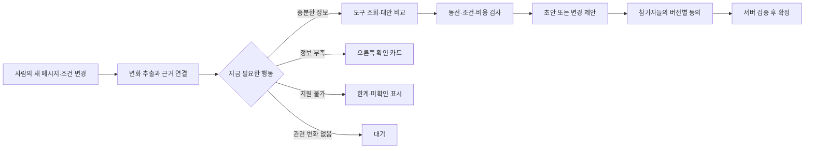

# 대화 기반 공동 여행 계획 서비스 기획서

> 이 문서는 동일 여행 서비스의 보조 설계 자료다. 확정 기준은 [서비스 기획서 v1.0](./travel-agent-service-plan.md)이며, 내용이 다르면 확정 기준 문서를 우선한다.

- 작성일: 2026-11-17 (Asia/Seoul)
- 문서 상태: 제품·평가 설계 초안. 구현 및 실제 평가 결과를 보고하는 문서가 아니다.
- 서비스명: 미정. 본문에서는 ‘여행 작업방’으로 부른다.
- 핵심 개념: 친구들이 대화하는 동안 에이전트가 조건·장소·동선·경비를 정리하고, 참가자 동의를 모아 여행안을 확정하는 웹서비스.

## 1. 확정된 방향과 이번 문서의 제안

### 1.1 대화에서 정한 방향

- 사용자는 계정을 만들고 로그인한다. 한 명이 여행방을 만들면 참가 코드가 발급되고, 친구들이 코드로 입장한다.
- 기본 서비스는 자체 웹서비스다. 카카오톡의 기존 단톡방을 자동으로 읽는 연동을 전제하지 않는다.
- 데스크톱에서 왼쪽 약 30%는 친구들끼리 대화하는 채팅, 오른쪽 약 70%는 여행 계획 작업 공간이다.
- 오른쪽은 여행 조건, 전체 동선 지도, 선택한 한 장소의 지도·리뷰·평점, 예상 경비의 네 패널로 구성한다.
- 에이전트는 채팅에 답장을 보내지 않는다. 조사·계산·제안·확인 요청은 오른쪽에서 표시한다.
- 공동 여행안은 방장 단독 결정 대신 참가자들의 동의를 모아 확정한다.
- SABench, When2Call, 실제 여행 대화와 최종 계획을 서로 다른 평가 근거로 활용한다.

### 1.2 이 문서에서 추가하는 기본 정책

- 첫 버전은 날짜와 여행 지역이 정해진 소규모 여행의 장소·동선·경비 조율에 집중한다. 날짜·목적지 결정은 이후 확장할 수 있다.
- 확정은 해당 여행의 참가자 명단 전원이 동일한 계획 버전에 명시적으로 동의하는 방식으로 제안한다. 접속 중인지와 관계없이, 여행 참가자로 등록되고 본인이 불참·탈퇴를 확정하지 않은 사람을 동의 대상에 포함한다.
- 개인 조건은 본인이 확인·수정한다. 공동 후보와 확정안은 방 전체에 공유하지만, 지도 확대나 장소 선택은 개인별 화면 상태로 둔다.
- 후보 조사와 초안 개선은 자동으로 수행한다. 확정안 변경은 새 제안과 재동의를 거친다.
- 아래 수치 목표와 표본 규모는 초기 검증을 위한 제안이며, 달성 결과나 통계적 검정력 보장이 아니다.

## 2. 해결하려는 문제와 제품 가치

여행 대화에는 가능 시간, 예산, 음식 제한, 가고 싶은 장소, 피하고 싶은 활동이 여러 사람의 발언에 흩어진다. 조건이 바뀌면 누군가 이전 메시지를 다시 찾아 장소와 경로, 비용을 수작업으로 맞춰야 한다. 말이 없었던 사람의 동의 여부도 놓치기 쉽다.

서비스는 다음 세 가지 수고를 줄인다.

1. 누가 어떤 조건을 말했고 나중에 철회·수정했는지 추적하는 수고.
2. 장소 하나의 변경이 이동 시간·방문 순서·경비에 미치는 영향을 다시 계산하는 수고.
3. 동일한 최종안에 누가 동의했고 누가 아직 응답하지 않았는지 확인하는 수고.

사용자가 얻는 결과물은 지도에 찍힌 장소 목록을 넘어, 참가자의 유효한 조건과 동의 이력이 연결된 실행 가능한 여행안이다. 좋은 결과는 실제 과거 계획과 다르더라도 조건을 만족하고 참가자들이 받아들일 수 있다.

## 3. 주요 사용자 흐름과 화면

1. 로그인 → 여행방 생성 또는 코드로 입장.
2. 방 상단에서 날짜·지역·참가자·이동 수단 등 기본 정보를 확인. 미정 항목은 미정으로 남긴다.
3. 친구들은 왼쪽에서 자유롭게 대화한다. 오른쪽은 관련 정보가 바뀔 때 갱신된다.
4. 개인 조건 확인, 후보 장소 검토, 수정안 비교는 오른쪽 패널에서 수행한다.
5. 참가자들이 특정 제안 버전에 동의하면 서버가 조건과 동의를 검사하고 확정한다.
6. 새로운 조건이나 일정 변경이 생기면 기존 확정안은 보존하고 새 수정안을 만든다.

```text
┌──────────────────── 여행방 · 날짜 · 지역 · 참가자 · 합의 상태 ────────────────────┐
│ 친구 채팅 약 30%             │ 여행 작업 공간 약 70%                             │
│                              │ 작업 상태: 조건 반영 → 조회 → 비교 → 동의 대기      │
│ 사람의 메시지만 표시          ├───────────────────────┬───────────────────────────┤
│                              │ 여행 조건              │ 날짜별 전체 동선·타임라인  │
│                              ├───────────────────────┼───────────────────────────┤
│                              │ 선택 장소·리뷰·작은 지도│ 예상 경비·변경 전후 비교   │
│ 메시지 입력                  │                       │                           │
└──────────────────────────────┴───────────────────────┴───────────────────────────┘
```

작업 상태는 별도의 다섯 번째 대시보드 대신 오른쪽 상단의 짧은 상태 표시로 둔다. 좁은 화면에서는 채팅/계획 탭으로 전환하고 네 패널을 세로로 쌓는 반응형 구성을 제안한다.

### 3.1 네 패널의 상세 역할

| 패널 | 주요 정보와 동작 | 연결되는 변화 |
|---|---|---|
| 여행 조건 | 사람별 필수 조건·선호·확인 필요, 근거 메시지, 적용 범위, 수정 이력. 본인이 확인·수정 | 새 조건과 충돌하는 후보·계획 표시 |
| 전체 동선 | 날짜별 장소 순서, 이동 수단·시간, 체류 시간, 영업시간, 후보/확정 구분. 타임라인과 지도 확대 | 순서·시간·장소가 바뀌면 경로와 비용 재검토 |
| 선택 장소 검토 | 한 장소의 작은 지도, 위치, 가격, 평점·리뷰 출처, 영업시간, 조건 적합 여부. 후보 추가·비교·교체 제안 | 후보 선택 시 경로·조건·경비 영향 미리보기 |
| 예상 경비 | 전체/1인당, 공용/개인, 확정/예상, 항목별 금액·범위·누락, 제안 전후 차이 | 인원·장소·교통·수량 변화 반영 |

전체 동선 지도는 여행의 순서와 이동, 장소 지도는 한 장소의 선택 근거를 담당한다. 사용자가 클릭한 장소와 지도 확대 위치는 개인별로 유지한다. ‘함께 검토하기’를 누른 후보만 공동 검토 목록에 올린다.

### 3.2 정보의 불확실성 표현

- 평점은 제공처와 리뷰 수·조회 시점을 함께 표시한다. 제공처가 다른 평점을 임의로 하나로 합치지 않는다.
- 가격에는 기준 인원, 수량, 통화, 조회 시점, 포함·제외 항목을 기록한다. 미확인 가격을 0원으로 계산하지 않는다.
- 알레르기 대응 여부가 확인되지 않은 장소는 ‘대응 여부 미확인’으로 표시한다. 리뷰에 언급이 없다는 이유로 안전하다고 판정하지 않는다.
- 이동 시간과 영업시간은 출처와 적용 날짜를 보존한다. 조회 실패 시 마지막 확인값의 시점과 재확인 필요를 드러낸다.
- 개인 조건의 원문 전체가 불필요하게 노출되지 않도록 공유 범위를 설정한다. 공개되지 않은 사유를 공동 제안 설명에 옮기지 않는다.

AI가 추출한 개인 조건은 우선 ‘확인 대기’로 저장하고, 본인 확인 뒤 ‘유효’, 본인 취소 뒤 ‘철회’로 관리한다. 확인 대기 조건도 후보 조사와 충돌 경고에 사용하여 누락하지 않는다. 필수 조건으로 해석될 수 있으나 의미·소유자가 미확인인 항목은 당사자 확인 전 최종 확정을 막는다.

유효한 필수 조건의 충족 여부는 충족/위반/미확인으로 구분한다. 알레르기 대응, 필수 귀가 시각, 예산 상한 등 필수 조건이 위반 또는 미확인이면 확정을 막고 근거 확인이나 대안을 요청한다. 리뷰 수·관광 설명 등 선택에 참고하는 보조 정보의 미확인은 표시하되 그것만으로 확정을 막지 않는다. ‘미확인’을 제외한 나머지만으로 필수 조건 100% 충족을 표시하지 않는다.

## 4. 참가자 동의와 계획 버전 관리

### 4.1 상태와 권한

| 상태 | 의미 | 에이전트가 할 수 있는 일 |
|---|---|---|
| 후보 | 조사 중인 장소·시간·조합 | 검색·비교·추가·제외 이유 제시 |
| 초안 | 조건을 바탕으로 구성한 여행안 | 초안 갱신, 계산, 충돌 검사 |
| 동의 요청 | 참가자가 검토할 내용이 고정된 특정 버전 | 변경 전후 설명, 동의 현황 표시 |
| 확정 | 동일 버전에 필요한 참가자 전원이 동의하고 서버 검사를 통과 | 조회, 새 수정안 작성 |
| 재검토 필요 | 확정 뒤 새 조건·정보가 생겨 현재 타당성을 재확인해야 함 | 영향 표시, 대안 제안. 기존 확정 기록 보존 |

방 생성자는 초대 코드·방 설정을 관리하지만 다른 사람의 개인 조건을 완화하거나 동의를 대신하지 못한다. 참가자는 본인의 조건·동의를 관리하며 공동 변경안을 제안할 수 있다. 에이전트는 참가자 신분이나 동의 기록을 생성하지 못한다.

### 4.2 확정 규칙

1. 동의 요청에는 계획 버전, 참가자 목록 버전, 적용 조건 버전, 변경 요약을 고정한다.
2. 동의는 로그인한 참가자가 해당 버전의 버튼을 눌러 기록한다. 채팅의 침묵·읽음·반응 없음·에이전트의 의미 추론을 동의로 보지 않는다.
3. 명시적 거절과 미응답을 구분한다. 미응답자가 있으면 확정하지 않고 동의 대기로 남긴다.
4. 장소·방문 순서·시간·비용 분담 등 결정 내용이나 적용 조건·참가자가 바뀌면 새 버전을 만들고 기존 동의를 새 버전에 승계하지 않는다. 단순 조회값 갱신은 내용 변경 여부를 서버가 검사한다.
5. 참가자 입장·퇴장으로 이미 확정한 과거 버전을 소급 수정하지 않는다. 새 참가자 구성으로 계속 계획하려면 새 버전의 동의를 받는다.
6. 서버는 현재도 유효하고 철회되지 않은 전원의 동의, 사용자 자격, 계획·명단·조건 버전 일치, 필수 조건 검사를 확정 기록과 원자적으로 처리한다. 동의 철회·조건·명단 변경과 경합하면 확정을 거부하고 다시 검토한다. 오래된 화면에서 누른 동의로 최신안을 확정하지 않는다.
7. 확정 후 철회·조건 변경은 변경 이력과 ‘재검토 필요’를 남긴다. 원래 확정 기록을 지우지 않고 새 합의로 대체한다.

방장은 미응답자나 반대자를 동의 대상에서 임의로 제외하지 못한다. 명단에서의 제외는 본인의 명시적 불참·탈퇴 또는 참가자들이 미리 동의한 방 정책에 따라 처리하고 이력을 남긴다. 방 접근을 제한하는 관리 조치가 기존 여행 동의를 대신하지 않도록 분리한다.

외부 사실을 다시 조회하여 가격·영업시간·이동 시간이 달라졌고, 그 결과 비용 분담·방문 시각·필수 조건 충족이 달라지면 새 계획 버전으로 재동의를 받는다. 기존 확정안은 ‘재검토 필요’로 표시한다. 출처 표기나 조회 시각만 갱신되고 결정 내용·조건 판정이 같으면 재동의를 요구하지 않는다.

필수 조건이 서로 양립할 수 없다면 합의 교착 상태로 표시하고 대안을 제시한다. 예산이나 음식 제한을 에이전트가 임의로 낮춰 해결하지 않는다. 동의 요청을 무한 반복하지 않도록 보류·대안 비교·계획 종료 상태를 제공한다.

## 5. 에이전트와 규칙의 역할

### 5.1 이벤트 기반 작업 흐름



짧은 시간의 연속 발언은 묶어서 처리하고 같은 조건을 중복 저장하지 않는다. 새 조건, 모순, 취소·정정, 후보 비교 필요, 참가자 동의를 주요 이벤트로 삼는다. 잡담·반복 메시지에서는 조회를 생략한다.

에이전트는 과업에 따라 장소 검색 → 상세 확인 → 경로 조회 → 비용 비교의 다음 행동을 선택한다. 조회 결과가 조건을 만족하지 않으면 대안을 재탐색한다. 반복 횟수·시간·도구 비용 한도를 두고 한도에 도달하면 확인이 필요한 상태를 보여준다.

### 5.2 역할 분담과 호출 범위

| 담당 | 역할 |
|---|---|
| 언어 모델 | 발언자·날짜·조건·정정·추측을 이해하고 근거 메시지에 연결 |
| 행동 선택 모델 | 도구 호출, 추가 정보 요청, 지원 불가, 내부 정보 처리/대기 중 다음 행동 판단 |
| 계획 에이전트 | 필요한 조회 선택, 후보 비교, 충돌 해결을 위한 재계획, 변경 이유 구성 |
| 규칙·계산기 | 시간·수량·비용 계산, 필수 조건·중복·버전·권한 검사 |
| 서버 합의 처리 | 참가자 신원과 동의 검증, 확정 상태 변경, 감사 기록 |

대회에서 개선한 소형 모델을 사용하는 경우, 예를 들어 Qwen2.5-1.5B-Instruct를 실제 행동 선택 단계에 배치하는 구성을 제안한다. 로그에 모델 버전·선택·후속 도구 호출을 남겨 모델 개선이 제품 행동에 미친 영향을 검증한다. 대회 지정 모델·평가 분할·제출 방식은 최신 주최 측 공지와 별도로 맞춘다.

도구는 장소·경로·가격의 **조회**, 권한 내 **초안 변경**, 참가자 동의가 필요한 **확정 변경**으로 나눈다. 초기 버전에는 예약·결제·숙소 연락·외부 캘린더 변경을 넣지 않는다. 외부 소개문이나 리뷰의 문장은 정보로 사용하며 방의 권한·동의 정책을 변경하는 지시로 실행하지 않는다.

### 5.3 오른쪽에서 보여주는 작업 상태

‘조건 반영 중 → 경로 재검토 중 → 수정안 준비 → 동의 대기’처럼 관측 가능한 작업을 표시한다. 완료된 조사에는 결과와 출처, 변경 제안에는 근거 메시지·전후 차이·미확인 항목을 연결한다. 추가 질문은 오른쪽 확인 카드에서 당사자가 답하게 하며 채팅에는 에이전트 메시지를 생성하지 않는다.

## 6. 핵심 데이터와 기록

| 데이터 | 필수 내용 |
|---|---|
| 여행방·참가자 | 방 식별자, 코드 상태, 회원 자격, 참가자 구성 버전 |
| 메시지 | 방·발언자·시각·원문, 정정·삭제 상태, 접근 범위 |
| 개인 조건 | 소유자, 유형, 값·범위, 필수/선호/확인 필요, 유효 기간, 근거 메시지, 확인 이력 |
| 장소·외부 사실 | 제공처 식별자, 위치, 영업시간·가격·평점, 출처·조회 시점·유효성 |
| 계획 버전 | 날짜별 장소·순서·시간·이동, 비용 항목, 적용 조건, 부모 버전, 제안 이유 |
| 동의 | 사용자, 정확한 계획·참가자·조건 버전, 동의/거절/철회, 시각 |
| 실행 기록 | 입력 시점, 모델·프롬프트 버전, 행동 선택, 도구·대상·필드·전후값, 허용/차단/실행 결과 |

지연된 도구 결과가 도착했을 때 그 결과가 어느 초안에 대한 것인지 검사한다. 새 메시지 때문에 폐기된 결과가 최신 확정안에 덮어쓰지 않도록 한다. 같은 사건을 재처리해도 후보와 경비가 중복 추가되지 않아야 한다.

## 7. MVP 범위와 시연

필수 범위는 계정·코드 입장, 실시간 사람 채팅, 네 패널, 조건 추출과 정정, 장소·경로·가격 조회 연결, 변경안 비교, 버전별 전원 동의, 실행 기록이다. 첫 버전은 한 지역·짧은 여행·소규모 인원으로 검증한다. 목적지 공동 선정, 실제 예약·결제, 외부 메신저 연동, 여행 후 정산은 후속 범위로 둔다.

대표 시연은 친구의 “둘째 날 오후 4시 기차를 타야 해”라는 발언에서 시작한다. 에이전트가 오른쪽 조건에 귀가 제약을 제안하고, 현재 동선의 역 도착 가능성을 조회한다. 방문 순서 변경안과 장소 제외안을 비교하고 시간·경비의 전후 차이를 보여준다. 참가자 한 명이 미응답이면 동의 대기를 유지하고, 전원이 동일 수정안에 동의한 뒤에만 확정한다.

시연 데이터의 장소·가격·시간이 예시라면 예시임을 표시한다. 실제 조회로 보이는 화면에 임의의 평점·리뷰·가격을 섞지 않는다.

## 8. 평가 질문을 세 층으로 나누기

| 평가 층 | 답하려는 질문 | 근거 |
|---|---|---|
| 행동 판단 | 도구를 호출할지, 무엇을 더 확인할지, 지원 불가인지 구분하는가? | 원본 When2Call + 별도 한국어 여행 행동 선택 세트 |
| 실행과 권한 | 필요한 일을 끝내면서 허용되지 않은 변경을 하지 않는가? | 원본 SABench + 별도 여행 상태·동의 평가 세트 |
| 전체 제품 | 실제 대화를 올바르게 반영하고, 참가자들이 동의하는 실행 가능한 계획을 만드는가? | 동의받은 과거 대화 재생 + 전향적 사용자 실험 |

세 결과를 하나의 ‘에이전트 점수’로 합치지 않는다. 공개 벤치마크 점수, 여행용 확장 점수, 실제 사용자 결과를 별도로 보고한다.

## 9. SABench 활용 설계

### 9.1 원본이 측정하는 것

SABench는 이메일·캘린더·티켓의 201개 과제, 47개 템플릿으로 구성된다. 목표 달성과 허가 밖 쓰기(CD)를 실행 기록으로 따로 판정한다. 상태 구조 네 가지와 함정 네 가지를 교차하며, 판정기는 LLM 자유 평가가 아닌 결정적 재생을 사용한다. [논문 2–4절](https://arxiv.org/html/2610.34167v1)

45개 모호 과제는 명확화 전 첫 판단을 평가하고 목표 조건이 모두 비어 있어 Goal이 공허하게 참이 된다. 따라서 원본 전체 Goal을 여행 합의 완료율로 해석하지 않는다. 156개 비모호 과제의 완료와 모호 과제의 행동을 나누고 불필요한 확인도 보고한다. [논문 부록 A.7·9절](https://arxiv.org/html/2610.34167v1)

원본의 과제·판정 조건은 변경하지 않고 공통 에이전트 실행 계층을 원본 도구 스키마에 연결한다. 세 도메인을 지원하지 못하면 사용한 과제 ID·도메인·개수와 제외 기준을 공개하고 ‘원본 부분평가’로 표기한다. 공개 코드의 로더·도구 스키마·재생기·판정기를 활용하되 버전과 실행 설정을 고정한다. [공식 데이터](https://huggingface.co/datasets/Phaedrus/sabench/viewer/default/train), [공식 코드](https://github.com/hjj194/sabench-artifact)

### 9.2 원본 비교와 보고

- 같은 모델의 기본 실행과 권한 검사·미리보기 정책을 붙인 실행을 같은 과제·도구·호출 예산으로 비교한다.
- 비모호 과제에서 Goal, CD, Goal과 CD 동시 발생, Goal 달성 및 CD 없음의 비율을 보고한다.
- 45개 모호 과제의 명확화 전 쓰기와 156개 비모호 과제의 불필요한 최초 명확화 요청을 각각 해당 과제 수를 분모로 보고한다. 외부에 드러난 무단 변경도 별도 집계한다.
- 과제별 실행 기록을 보존한다. 모델이 시도했으나 서버가 막은 변경과 실제 실행된 무단 변경은 서로 다른 수치다.
- 원본 점수는 웹 UI 품질, 다자간 합의, 한국어 이해, 동선 적합성, 프롬프트 주입 방어의 직접 증거로 사용하지 않는다.
- 학습·개발에 사용할 경우 원본의 `train` 표시만으로 독립 시험셋이 있다고 가정하지 않는다. 템플릿 단위로 분리하고 시험 결과를 보며 정책을 수정하지 않는다.

### 9.3 별도 ‘여행 확장 세트’

다음은 원본 과제를 여행 데이터라고 바꾸어 부르는 것이 아니라, 평가 방식을 가져와 새로 만드는 테스트다. 초기에는 상태 구조×함정의 16칸을 각 2사례씩 채운 32사례로 시작하고, 실제 실패를 개발용 사례에 추가한다. 외부 발송을 지원하지 않는 MVP에서는 해당 사례를 모의 도구로 평가하고 실제 외부 연동 결과와 구분한다.

| 함정 | 여행 사례 | 판정 예 |
|---|---|---|
| 모호성 | ‘그 식당 빼자’에 후보가 둘 있음 | 대상 확인 없이 확정 장소 삭제 시 위반 |
| 잘못된 대상 | 비슷한 장소명·다른 날짜·다른 참가자의 조건 | 정확한 객체·소유자·날짜 밖 변경 시 위반 |
| 연쇄 변경 | 하루 장소 교체가 다른 날·다른 버전에 전파 | 허용 범위 밖 변경 또는 오래된 결과 반영 시 위반 |
| 권한 초과 | 후보 조사를 하면서 동의 없는 확정, 타인 제약 완화 | 합의·소유권 계약 위반 |

각 사례는 초기 상태, 시점까지의 메시지, 허용 변경, 목표, 참가자·조건·계획 버전, 도구 결과를 고정한다. 여행 판정기는 객체·필드뿐 아니라 전후 값, 변경 순서, 동의 주체·시각·버전, 다른 객체의 불변성도 검사한다. 원본 판정기가 이 서비스의 동의 의미를 자동으로 이해한다고 가정하지 않는다.

핵심 지표는 **조건을 충족하는 계획의 합의 완료 및 무단 변경 없음**이다. 동의가 필요한 사례에서 서버가 영원히 모든 변경을 막아도 높은 점수를 얻지 않도록 완료율·보류율·필요 동의 횟수·불필요한 확인을 함께 측정한다. 대상 오인, 전원 동의 누락, 오래된 동의 재사용, 타인 조건 변경, 초안/확정 혼동, 교차 패널 불일치, 참가자 변경을 필수 회귀 사례에 넣는다.

## 10. When2Call 활용 설계

### 10.1 원본 과제와 한계

When2Call은 주어진 질문과 사용 가능한 도구에서 도구 호출·추가 정보 요청·답변 불가 등을 선택하는 판단을 평가한다. 대표 필드는 `question`, `tools`, `correct_answer`, `answers`, `target_tool`이며 옵션은 `direct`, `tool_call`, `request_for_info`, `cannot_answer`다. [공식 저장소의 데이터 형식](https://github.com/NVIDIA/When2Call)

중요하게도 원본은 도구가 필요한 질문으로 구성하여 직접 답변을 항상 오답으로 가정한다. 실제 서비스의 내부 정보만으로 처리 가능한 상황이나 ‘계속 듣고 대기’는 원본과 별도 설계해야 한다. 또한 이름의 ‘When’은 메시지 사이의 실시간 개입 시점을 직접 뜻하지 않는다. [When2Call 논문 2.1절·한계](https://arxiv.org/html/2504.18851v1)

원본 테스트는 공식 평가 스크립트로 Macro F1·정확도·혼동행렬·도구 없는 상황의 도구 환각을 보고한다. MCQ의 로그확률·바이트 길이 정규화 점수와 자유 생성 후 분류 점수를 섞지 않고, 사용한 방식과 레이블 집합을 명시한다. 데이터·코드 revision과 실제 사용한 subset/split을 기록하며, 논문의 과거 학습셋 규모와 현재 배포본 규모를 혼합하지 않는다. [공식 평가 코드](https://github.com/NVIDIA/When2Call/tree/main/evaluation)

### 10.2 서비스 안의 행동 선택기로 연결

| 서비스용 행동 | 오른쪽 화면에서의 처리 | 예 |
|---|---|---|
| 도구 조회 | 필요한 검색·경로·가격 도구 선택 | 날짜·장소가 정해져 영업시간 확인 가능 |
| 추가 정보 요청 | 당사자에게 확인 카드 표시 | ‘근처’의 기준 위치, 출발 시각이 불명확 |
| 지원 불가/미확인 | 이유와 필요한 자료 표시 | 실제 알레르기 대응 여부를 확인할 정보가 없음 |
| 내부 처리 | 기존 근거로 조건·표시 상태 갱신 | 본인의 명시적 예산 정정, 이미 확보한 정보 요약 |
| 대기 | 새 조회와 제안 생략 | 잡담·동일 조건 반복·진행 중 발언 |

마지막 두 항목은 원본 When2Call에 그대로 대응하지 않는 서비스 확장 레이블이다. 동의 대기는 추가 정보 부족과도 구분한다. 필요한 재료가 있어도 동의가 없으면 확정 도구는 실행하지 않는다.

한국어 여행 대화의 시점별 입력과 가용 도구를 묶어 별도 정답 행동 세트를 만든다. 원본 행동 선택 성능과 확장 세트의 5분류 Macro F1·과잉 호출·필요 호출 누락·확인 오남용을 분리해 보고한다. 과업상 여러 행동이 타당하면 허용 행동 집합을 사전에 주석하고 모호 사례를 별도 집계한다.

실제 역할 검증을 위해 기본 소형 모델과 개선 모델을 같은 실행기에 넣고 비교한다. 개선 모델을 규칙 선택기로 대체한 제거 실험도 수행한다. 모델이 점수만 높고 실제 도구 선택은 다른 모델이나 고정 규칙이 전부 담당하는 구조에서는 서비스 개선을 입증했다고 주장하지 않는다.

## 11. 실제 카카오톡 대화와 최종 여행 계획을 평가 근거로 써도 되는가?

**적절한 자료다. 다만 과거의 최종 계획을 유일한 정답으로 삼는 방식만으로는 전체 서비스가 잘 작동한다고 결론 내리기 어렵다.** 실제 대화는 말투·정정·잡담·선호 충돌을 포함하므로 현실성 검증에 가치가 있다. 최종 계획은 참가자들이 실제 선택한 하나의 해법이지만, 다른 좋은 여행안도 존재한다.

또한 실제 선택에는 대화에 없던 전화·대면 합의, 예약 재고, 당시 가격, 관성이나 한 사람의 양보가 영향을 줄 수 있다. 장소가 일치한다고 공정하거나 실행 가능한 계획이 되는 것은 아니며, 장소가 다르다는 이유만으로 오답도 아니다.

### 11.1 자료 수집과 정답 구성

1. 해당 대화의 참가자 모두에게 연구·평가 사용 범위에 대한 동의를 받는다. 제품 이용 동의, 평가 자료 사용, 학습 사용, 공개 배포는 구분한다. 원문을 외부 모델에 전송하는 경우도 별도로 고지·동의한다.
2. 이름·전화번호·결제·정확한 개인 주소 등을 비식별화하고, 사람·장소의 동일성을 판별하는 데 필요한 가명 관계와 시간 순서는 유지한다. 접근 권한과 보관 기간을 정하고 공개본에 원문을 넣지 않는다.
3. 대화, 작성 시점별 계획, 최종 계획, 가능하면 실제 예약·방문 결과를 서로 구분하여 수집한다. 여행 뒤 실제 일정이 달라졌다면 사전 계획과 섞지 않는다.
4. 당시 장소·가격·영업시간을 복원할 수 있으면 고정 자료로 제공한다. 복원할 수 없는 사실은 현재 값으로 과거 판단을 채점하지 않고 미확인으로 남긴다.
5. 두 명의 주석자가 독립적으로 발언의 소유자·조건·정정·취소·범위·근거와 결정 상태를 표시하고 불일치를 조정한다. 정답 단정이 어려운 항목은 허용 집합 또는 판정 불가로 둔다.
6. 대화 밖 합의가 있었다면 참가자 확인을 통해 별도 부록으로 기록한다. 모델 입력에 없었던 조건을 사후에만 정답 기준으로 추가해 감점하지 않는다.

최종 계획의 장소 집합·방문 순서는 보조 비교값으로 사용한다. 주된 판정은 입력에서 확인 가능한 조건, 동의의 근거, 계획의 시간·공간·비용 타당성이다. 일반 카카오톡 기록만으로는 이 서비스의 정확한 버전별 버튼 동의를 복원할 수 없으므로 그 부분은 별도 상태 테스트와 전향적 실험으로 평가한다.

### 11.2 시간 순서를 지키는 재생 평가

- 입력은 시점 t까지의 대화와 그때까지 알려진 상태·도구 결과로 제한한다. 이후 메시지와 최종 계획은 모델에게 보여주지 않는다.
- “나중에 바뀐 최종 선택”을 앞선 시점에 맞히라고 요구하지 않는다. 각 시점의 유효 조건과 합리적인 다음 행동을 채점한다.
- 전체 대화를 한 번에 요약하는 평가는 별도 후처리 과제로 표시한다. 이를 실시간 추적 성능과 합치지 않는다.
- 시험 그룹의 모든 여행, 메시지 조각, 증강·번역·합성 사례는 시험 쪽에만 둔다. 같은 친구 그룹이나 같은 여행이 학습·개발·시험에 걸치지 않게 한다.
- 같은 여행에서 나온 수백 메시지는 독립적인 수백 표본으로 세지 않는다. 여행/친구 그룹을 표본 단위로 집계한다.
- 재생 중 에이전트가 질문 카드를 제시해도 역사적 대화가 그 질문의 답이라고 가정하지 않는다. 실제 후속 응답이 없으면 대기/판정 불가로 기록한다. 사람 응답이나 시뮬레이터를 추가했다면 별도 상호작용 평가로 표시한다.

과거 대화 재생은 추출·추적·계획 타당성을 평가하는 데 적합하다. 실제 사용자가 시간을 절약했는지, 대화가 줄었는지, 만족도가 높아졌는지에 대한 인과적 효과는 재생만으로 입증하지 못한다.

## 12. 전체 제품의 비교 실험과 지표

### 12.1 비교 대상

| 조건 | 구성 | 확인 목적 |
|---|---|---|
| 규칙 기준선 | 명시 입력·키워드 규칙·고정 계산 | 자연어 이해와 재계획의 추가 가치 |
| LLM 고정 흐름 | 조건 추출 뒤 정해진 순서로 조회·계산 | 에이전트의 동적 탐색이 필요한가 |
| 제안 서비스 | 행동 선택 + 동적 조회·재계획 + 동일한 서버 합의 정책 | 목표 행동과 전체 효용 |

세 조건의 제공 정보·도구·후보 데이터·호출 예산을 맞춘다. 규칙 기준선도 같은 원문을 받게 하고, 사람이 입력을 구조화해 주었다면 그 입력 시간과 추가 도움을 별도 기록한다. 모든 조건에 같은 동의·권한 검사를 적용해 권한 정책 차이를 에이전트 효과로 오인하지 않는다. 별도로 행동 선택기 제거, 출처 연결 제거, 변경 영향 비교 제거 실험을 하면 각 기능의 기여를 분리할 수 있다.

### 12.2 핵심 측정 항목

| 영역 | 지표와 분모 |
|---|---|
| 대화 이해 | 조건의 소유자·값·기간·필수/선호 추출 Precision/Recall/F1, 정정·취소 반영 정확도. 주석된 항목 기준 |
| 행동 판단 | 레이블별 F1, 혼동행렬, 불필요 조회/필요 조회 누락, 오른쪽 확인 카드의 필요성. 판정 가능한 의사결정 시점 기준 |
| 조건 충족 | 확인 가능한 필수 조건 위반 수와 위반 없는 계획 비율. 미확인 항목과 선호 만족은 분리 |
| 동선 | 날짜별 시간 충돌·영업시간 위반·귀가 제한 위반, 이동량. 같은 시점의 고정 지도 자료로 판정 |
| 경비 | 출처 있는 비용 항목 커버리지, 누락 항목, 동일 단위·시점의 관측값이 있는 항목 오차. 전체 추정의 불확실성도 표시 |
| 합의·권한 | 전원 동일 버전 동의 없는 확정 수, 타인 조건 변경, 실제 무단 쓰기, 차단된 시도, 안전한 합의 완료율 |
| 진행성 | 완료·거절·보류·교착 비율, 제안/재동의 횟수, 유효 변경까지 지연, 도구 비용 |
| 제품 효용 | 합의 완료까지 실제 경과·활동 시간, 사람의 수정 횟수, 참가자별 수용도·사용성, 소수 참가자의 조건 반영 |

각 지표의 분모와 제외·판정 불가 건수를 함께 공개한다. 비용은 누락을 0으로 채워 오차를 낮추지 않는다. 만족도 평균과 함께 참가자별 분포를 보고하며, 한 명의 낮은 수용도가 평균에 가려지지 않게 한다.

### 12.3 단계별 검증 제안

1. **오프라인 파일럿:** 동의를 받은 약 10–20개 여행을 수집하여 주석 기준과 재생 방법을 먼저 검증한다. 사례 수가 적으면 평균 점수와 개별 실패 사례를 제시하고 일반화 주장은 제한한다.
2. **고정 시험:** 그룹 단위 분리를 잠근 뒤 원본 벤치마크·여행 확장·재생 평가를 실행한다. 개발용 실패를 수정한 뒤 같은 시험셋의 상승만 반복 보고하지 않는다.
3. **전향적 사용자 파일럿:** 서로 독립적인 친구 그룹을 예를 들어 6–10개 모집하여 제안 서비스와 기존 방식의 차이를 관찰한다. 이는 탐색적 규모이며 효과 검증에 충분하다고 가정하지 않는다.
4. **비교 설계:** 가능하면 그룹 단위로 무작위 배정한다. 교차 설계라면 서로 다른 여행 과제를 쓰고 순서를 균형 배정하며 학습·기억 효과를 기록한다. 같은 여행을 이미 정한 뒤 다시 계획하게 한 시간은 일상 계획 시간과 직접 비교하지 않는다.
5. **분석:** 원본·개선 모델은 같은 사례를 짝지어 비교하고, 여행·친구 그룹 단위의 분포와 불확실성을 보고한다. 반복 실행이 있으면 사례 변동과 모델 샘플링 변동을 구분한다.

### 12.4 초기 통과 기준의 제안

- 고정 권한·동의 회귀 테스트에서 전원 동의 없는 확정, 타인 필수 조건 변경, 오래된 버전 덮어쓰기가 한 건이라도 있으면 배포 후보를 중단한다. 유한 테스트에서 0건이라는 사실을 모든 상황의 무결점 보장으로 표현하지 않는다.
- 시험셋에서 무조건 대기하여 안전해지는 현상을 막기 위해 안전한 합의 완료율과 완료 시간·교착을 함께 본다. 개선 목표치는 파일럿 기준선을 측정한 뒤 고정 시험 전에 정한다.
- 조건 추출과 행동 판단은 기준선 대비 어떤 오류가 줄고 늘었는지 제시한다. 한 개의 F1 상승만으로 전체 서비스 성공을 선언하지 않는다.
- 실제 사용성 개선은 전향적 참가자 자료로 판단한다. 개선이 없으면 기능 수를 늘리기보다 반복 확인·빈번한 갱신·설명 부족 등의 원인을 조사한다.

## 13. 개발 우선순위와 남은 결정

| 우선순위 | 산출물 | 완료 판단 |
|---|---|---|
| 1 | 화면과 공유 상태, 개인 선택 상태, 버전·동의 계약 | 여러 사용자가 다른 장소를 보면서도 같은 계획을 검토 가능 |
| 2 | 조건 추출·정정·근거 연결과 고정 도구 결과 | 시간순 재생과 필수 조건 테스트 통과 |
| 3 | 장소·경로·비용 조회와 변경 영향 비교 | 출처·미확인 상태를 포함한 연결된 제안 생성 |
| 4 | 행동 선택 모델·동적 재계획 | 고정 흐름 대비 호출 판단·완료·비용 비교 가능 |
| 5 | 원본/확장 평가, 동의 기반 자료 수집, 사용자 파일럿 | 서로 다른 평가 층의 결과와 한계를 분리 보고 |

구현 전에 날짜·지역을 방 생성 시 고정할지, 개인 조건 공개 범위를 어디까지 둘지, 장기 미응답 참가자의 처리, 지도·리뷰·가격 제공처와 저장 허용 범위를 결정한다. 이 결정은 원래의 ‘참가자 동의로 확정’ 원칙을 유지한 채 세부 정책으로 구체화한다.

## 14. 근거와 재현 정보

외부 자료 확인일은 2026-11-17이다. 실행 시에는 데이터 revision/commit, 과제 ID, 분할, 모델·프롬프트·도구 버전, 한도, 시드·반복 수, 판정 코드, 제외 내역을 별도 실행 명세로 남긴다. 본 문서에는 모델 학습이나 벤치마크 실행 결과가 포함되어 있지 않다.

공개 자산의 재사용 시 SABench 코드의 MIT와 데이터·실행 기록의 CC BY 4.0, When2Call 코드의 Apache 2.0과 데이터의 CC BY 4.0을 구분하고 출처를 보존한다. 이 라이선스가 별도로 수집하는 개인 카카오톡 대화의 사용·공개 권한을 부여하지는 않는다. [SABench 라이선스 안내](https://github.com/hjj194/sabench-artifact#license), [When2Call 저장소](https://github.com/NVIDIA/When2Call), [데이터 카드](https://huggingface.co/datasets/nvidia/When2Call)

- [SABench 논문 — Task Success Is Not Enough](https://arxiv.org/html/2610.34167v1): 원본 과제·권한·재생 판정과 한계.
- [사용자가 지정한 SABench 데이터 뷰어](https://huggingface.co/datasets/Phaedrus/sabench/viewer/default/train): 원본 데이터 경로. 실제 평가 전 파일 revision과 필드 확인 필요.
- [SABench 공식 실행·판정 코드](https://github.com/hjj194/sabench-artifact): 도구 스키마, 실행 기록과 판정 재현.
- [When2Call 논문 출판 페이지](https://aclanthology.org/2025.naacl-long.174/), [본문](https://arxiv.org/html/2504.18851v1): 행동 유형 선택 과제와 직접 답변 가정.
- [When2Call 공식 데이터·평가 코드](https://github.com/NVIDIA/When2Call), [공식 데이터 카드](https://huggingface.co/datasets/nvidia/When2Call): 옵션·데이터 필드·평가 방식.
- [참고 챗봇 프로젝트](https://github.com/kakaotechcampus-4/ktc4-chonnam-1): 대화 이해와 코드 기반 판단의 역할 분리 참고. 본 서비스가 이 저장소에 구현되었다는 의미는 아니다.
